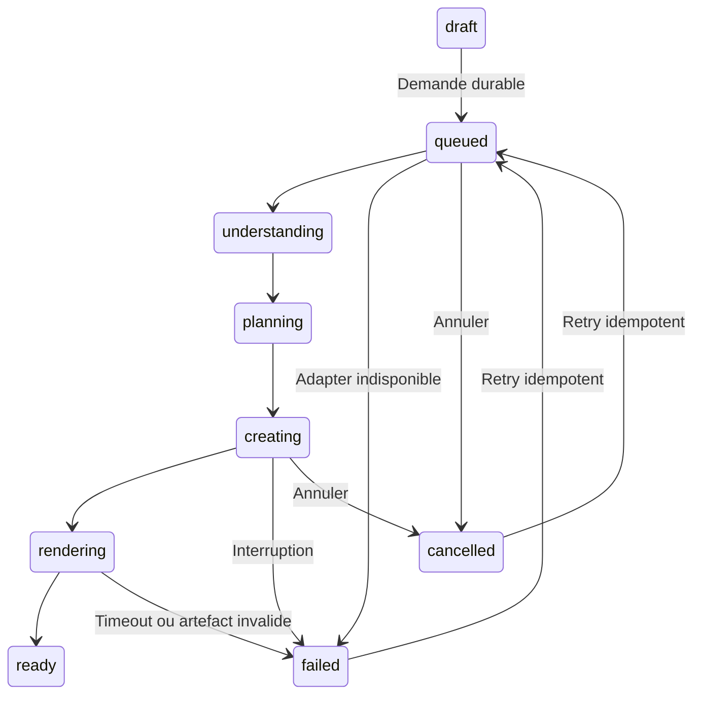

# Fabrya — produit client isolé

## Périmètre et origine

La source réellement servie de Fabrya a été récupérée par le mécanisme Sites au commit `4b7369b5bee6d400d13e0d52616ea88d87d4aab6`. Le dépôt GitHub `sempehugo03-jpg/signature-digital-core` est plus ancien : sa branche main pointe sur `23a73120cff88a1a299eacc5a77921ec8663cf49` et ne contient pas le runtime Vinext/D1 actuellement servi. Ces deux historiques n'ont pas été remplacés ou fusionnés.

Le nouveau parcours est un module Worker autonome dans `product/`, avec des tests dans `tests/product/` et des preuves dans `docs/product/`. Il utilise une base D1 de QA séparée, les contrats d'identité déjà utilisés par Fabrya et le produit/prix Stripe TEST existant. Il ne copie aucune implémentation du moteur Kévin. Sa frontière HTTP et son adapter n'ont aucune dépendance aux Supervisors, aux fournisseurs IA, aux fixtures ou aux références v115.

Le site public `fabrya.fr` n'a pas été déployé ou modifié. Les anciens parcours à 90 € restent dans l'ancienne source et ne sont pas utilisés par le nouveau module, où l'offre est exclusivement 59 € / mois. Leur remplacement sur le domaine public attend les gates produit et une autorisation de déploiement.

## Objets et persistance

| Objet | Stockage | Rôle |
|---|---|---|
| User / Session | `sd_platform_users`, `sd_platform_sessions` | Contrats email, PBKDF2, hash de token et cookie compatibles avec l'identité existante ; comptes de QA distincts de la base live |
| Company / Project / Brief | `fp_projects` | Entreprise comme objet de valeur, brief JSON borné, révision optimiste, étape, propriétaire, attribution immuable |
| GenerationJob | `fp_jobs` | ID durable, clé idempotente, snapshot d'entrée, handle d'adapter, état, tentative, erreur récupérable |
| Version / RevisionRequest | `fp_versions` | Numéro, source, demande de modification, artefact HTML et empreinte SHA-256 immuables une fois ready |
| Approval | `fp_approvals` | Projet, version, empreinte, utilisateur et horodatage figés |
| Checkout | `fp_checkouts` | Réservation persistée avant Stripe, clé idempotente dérivée de son ID, session Stripe et état |
| Subscription | `fp_subscriptions` | Référence Stripe TEST, état courant, tarif 5900 centimes EUR |
| Activation | `fp_activations` | Version/empreinte validées et session payée ; un seul enregistrement par projet |
| Webhook | `fp_webhooks` | Réception et traitement durables ; doublons traités idempotemment |
| Event | `fp_events` | ID, session, utilisateur/projet, nom canonique, timestamp ; aucun texte de brief, email ou mot de passe |

La création du job et de sa version est transactionnelle. Un index unique partiel empêche deux jobs en cours pour le même projet. La réservation Checkout précède l'appel Stripe : un crash après la réponse fournisseur retrouve la même session avec la même clé d'idempotence.

Le brief est sauvegardé par comparaison de `draft_revision`. Un conflit entre onglets est signalé et la saisie locale est conservée. La copie locale sert uniquement de boîte de sortie lors d'une perte de connexion ; D1 reste la source de vérité. Les versions prêtes ne sont jamais réécrites.

## Frontière moteur

```javascript
adapter.kind
adapter.createDemo({
  job_id, company_input, revision, version,
  mode, created_at, idempotency_key
}) // -> { job_id, handle }
adapter.getJob({ job_id, handle })
// -> { status, progress, recoverable, error, result }
adapter.cancel({ job_id, handle })
```

`company_input` : nom, activité, description, clientèle, localisation, objectif, problème actuel, site existant, éléments de marque, liens utiles et contraintes. Les liens sont des références de brief ; aucun upload n'est promis ni envoyé à un fournisseur dans ce module.

`result` : artefact HTML autonome, empreinte SHA-256, type média, source et indicateur mock. Le navigateur reçoit seulement une URL de preview autorisée pour son compte. Le HTML peut inclure des interactions locales : iframe sandboxée avec `allow-scripts`, sans `allow-same-origin`, sans formulaires ni accès réseau. Les assets doivent être autonomes/embarqués. Les secrets et les handles d'adapter ne sont jamais renvoyés au navigateur.

L'interface appelle :

```text
POST /api/product/projects/:id/jobs       -> { job_id }
GET  /api/product/projects/:id            -> project, job, versions, subscription, activation
POST /api/product/projects/:id/revisions  -> { job_id }
POST /api/product/projects/:id/jobs/:job/retry -> { job_id }
```

Contrat de `job` exposé : `job_id`, `status`, `progress`, `created_at`, `updated_at`, `recoverable`, `error`, `result`, `version`, `attempt`.

Le job existe AVANT tout appel à l'adapter. Le vrai adapter devra réutiliser la clé d'idempotence du job et de sa tentative, déposer le travail dans son exécution serveur durable et répondre rapidement à `createDemo`. L'UI ne change pas. Le point de composition serveur est `productHandler({ kevin: realAdapter, ... })` dans le Worker ; aucune autre logique produit n'a à connaître l'implémentation moteur.

L'adapter déterministe n'appelle aucun fournisseur. Son handle durable contient l'heure de départ et le snapshot. Les étapes sont calculées à partir du temps écoulé et matérialisées lors de la lecture suivante ; aucun processus Work ou onglet n'est nécessaire pour retrouver un résultat prêt. Cela ne prétend pas démontrer l'exécution asynchrone du futur moteur réel.

## États canoniques



| État | Sémantique |
|---|---|
| draft | Brief pas encore soumis ; sauvegarde et comparaison de révision |
| queued | Job enregistré, en attente de prise en charge |
| understanding | Compréhension métier en cours |
| planning | Direction de l'expérience en cours |
| creating | Production de la proposition |
| rendering | Vérification / finalisation de l'artefact |
| ready | Artefact durable disponible |
| failed | Tentative interrompue, code d'erreur canonique et récupération explicite |
| cancelled | Annulation conservée ; possibilité de retry |

Aucun pourcentage artificiel. L'UI utilise les libellés des états canoniques et n'interprète pas les textes internes du moteur.

## Paiement et activation

Prix réutilisé : `price_1UO5oJA4NzNcjm7qxb3LOYwC`, produit `prod_VOtb4X0VYbOkW3`, compte Stripe TEST `acct_1QDQzUA4NzNcjm7q`. Tarif lu réellement : 5900 centimes EUR, mensuel, actif, mode test, installation 0. La qualification HT/TTC n'a pas été inventée.

Le gateway lit exclusivement des clés TEST. Il vérifie le prix avant Checkout et refuse toute réponse `livemode=true`. Aucun prix/produit supplémentaire n'a été créé. Le checkout n'a ni frais d'installation, ni promotion, ni période d'essai ajoutée.

Variables serveur nécessaires sur l'environnement QA :

- `FABRYA_PRODUCT_STRIPE_TEST_KEY` (ou la clé existante `STRIPE_SECRET_KEY_TEST`)
- `FABRYA_PRODUCT_STRIPE_TEST_PRICE` (déjà fixé au prix existant)
- `FABRYA_PRODUCT_STRIPE_TEST_WEBHOOK_SECRET` pour ce nouvel endpoint

L'activation exige un Checkout Stripe TEST complet et payé, le bon montant/devise, les bons identifiants de projet/approbation/checkout/utilisateur et un abonnement courant actif correspondant au prix. Le retour `?payment=success` ne fait qu'afficher la vérification. Un endpoint serveur de réconciliation peut confirmer le paiement même si le webhook est en retard.

Le webhook vérifie le corps brut, HMAC SHA-256 et la fenêtre de cinq minutes. Les événements d'abonnement relisent l'état courant de Stripe pour résister au désordre des livraisons. Un ancien callback ne remplace pas une version active plus récente. Un abonnement annulé ne crée pas automatiquement un deuxième abonnement : le client retrouve la gestion du précédent.

La QA privée Sites protège tous les endpoints par la politique d'accès propriétaire. Un webhook Stripe entrant direct aurait donc aussi besoin d'une route d'ingress autorisée ou d'un relais serveur authentifié, sans exposer la clé de service dans une URL. Ce raccordement n'est pas inventé ni présenté comme vérifié.

## Exécution et builds

Node 24 est utilisé pour les tests SQLite natifs. Les dépendances produit sont verrouillées dans `product/package-lock.json`.

```bash
npm ci --prefix product
npm --prefix product run test
npm --prefix product run build
```

La migration initiale est générée à partir du schéma Drizzle du produit et a été appliquée à la base QA par Sites. Elle est destinée à une base isolée neuve : il ne faut pas l'appliquer telle quelle à la base live existante. Une future intégration doit conserver les tables d'identité live et ajouter seulement les tables `fp_*` par une migration additive vérifiée.

L'artefact est un Worker ESM autonome avec `default.fetch`, la landing, les assets et le backend embarqués. Aucun cron, workflow, Supervisor ou endpoint Kévin n'est inclus dans le Worker produit. Le répertoire de publication privé ne contient que le produit et ses tests/migrations, pas le moteur ou les anciens parcours.
